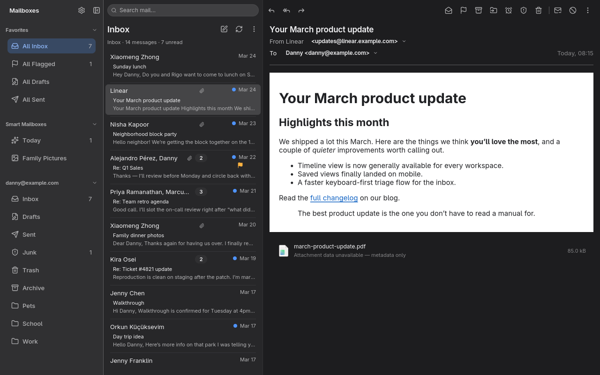
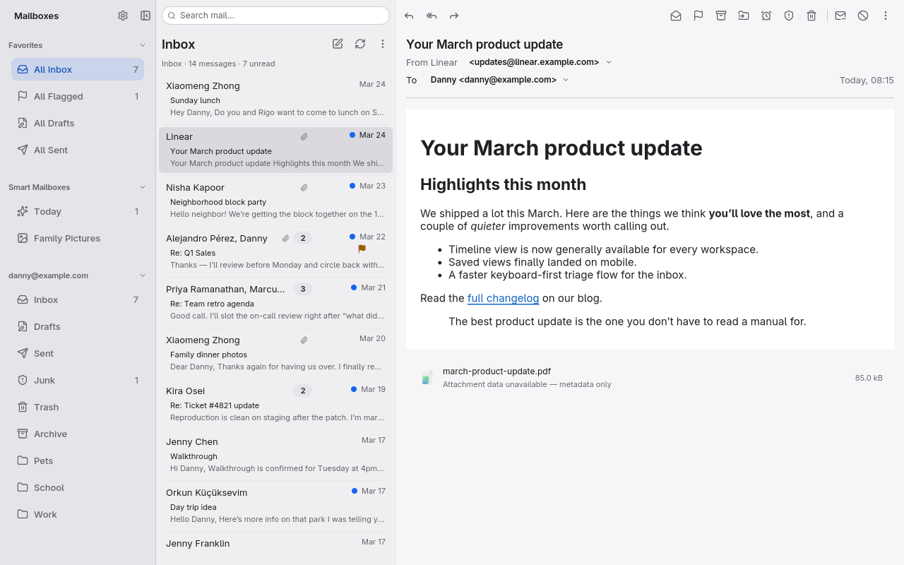
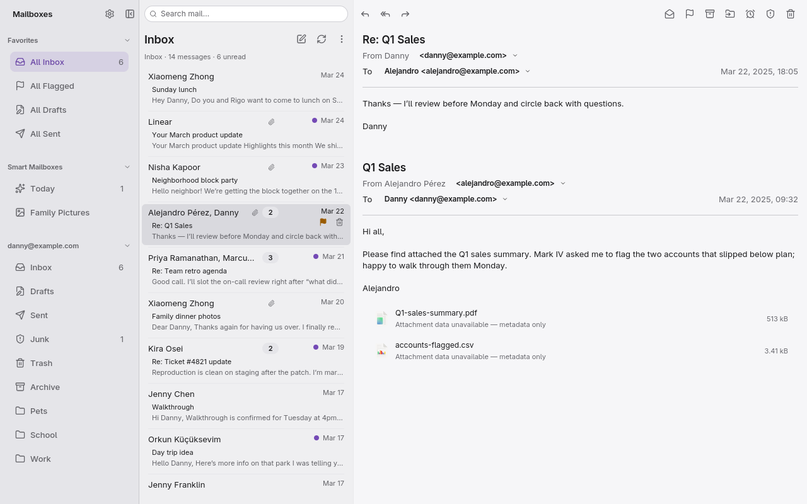
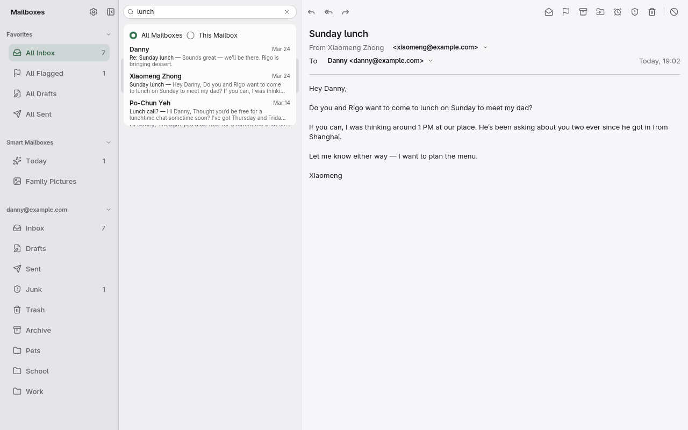
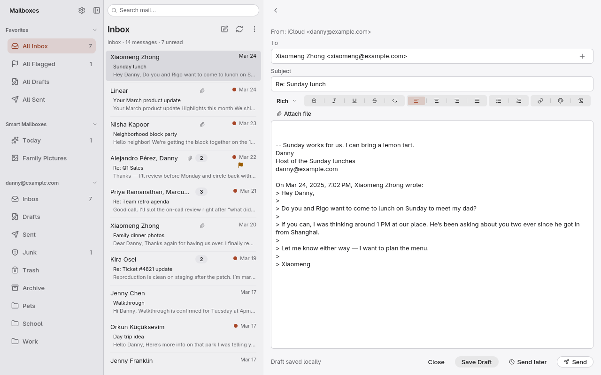
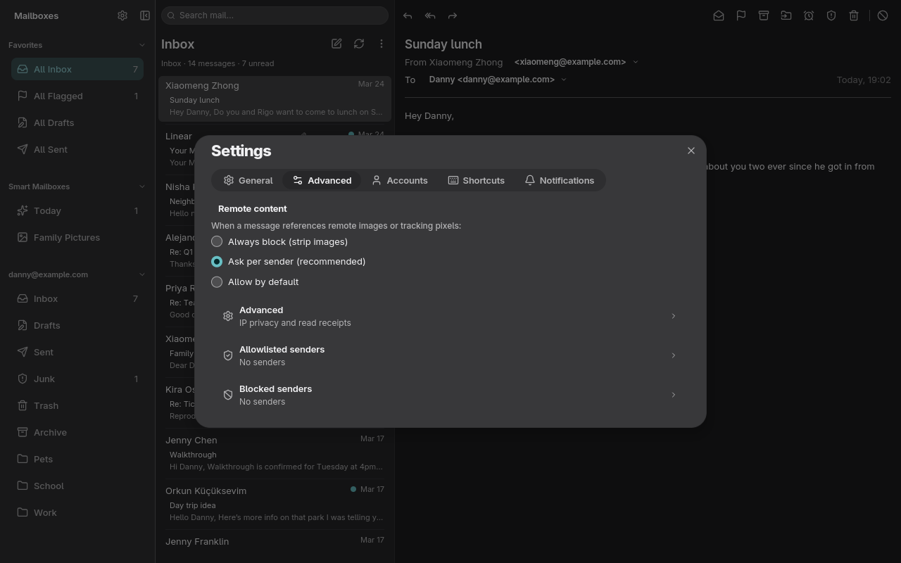
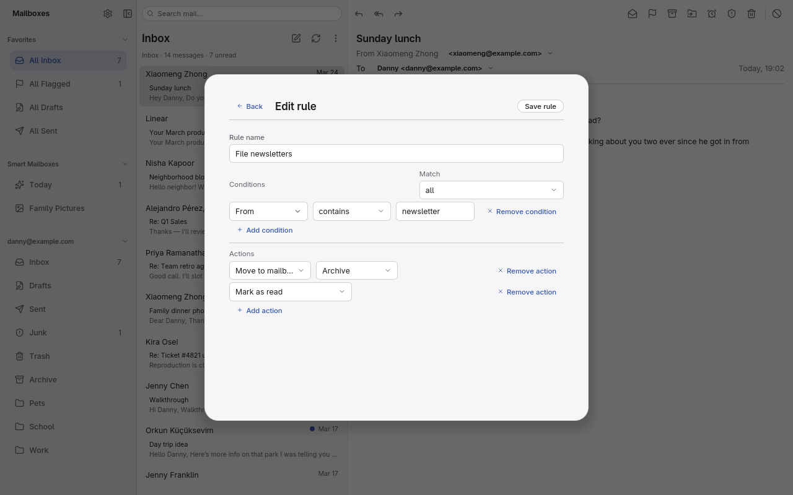
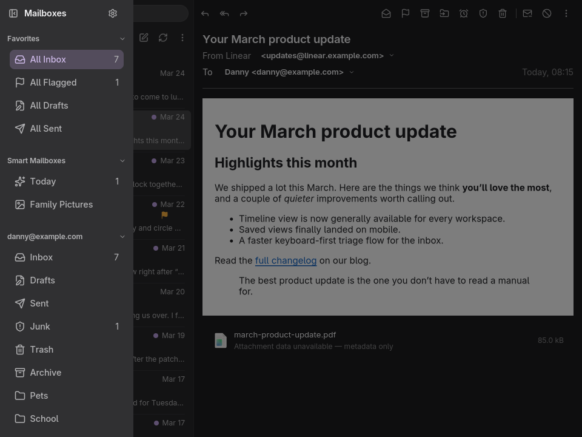

# Mail

Read and organize IMAP mail in a native desktop interface. Built with [enzUI](https://github.com/enz1m/enzui).

<table>
  <tr>
    <td align="center"><a href="docs/screenshots/basic-dark.png"></a><br><sub>Inbox · Dark</sub></td>
    <td align="center"><a href="docs/screenshots/basic-light.png"></a><br><sub>Inbox · Light</sub></td>
  </tr>
  <tr>
    <td align="center"><a href="docs/screenshots/lavender.png"></a><br><sub>Conversation thread</sub></td>
    <td align="center"><a href="docs/screenshots/sage.png"></a><br><sub>Search</sub></td>
  </tr>
  <tr>
    <td align="center"><a href="docs/screenshots/ember.png"></a><br><sub>Compose</sub></td>
    <td align="center"><a href="docs/screenshots/lagoon.png"></a><br><sub>Privacy settings</sub></td>
  </tr>
  <tr>
    <td align="center"><a href="docs/screenshots/precision.png"></a><br><sub>Rule editor</sub></td>
    <td align="center"><a href="docs/screenshots/comfort.png"></a><br><sub>Compact sidebar</sub></td>
  </tr>
</table>

Click any screenshot to enlarge. The screenshots use fictional messages and shared enzUI themes.

## Features

- Multiple IMAP accounts, folders, search and message threads.
- Rich message viewing, attachments and composition.
- Scheduled sends, undoable moves and desktop notifications.

## Build and run

Use Rust **1.99.1** (minimum **1.95**), a C/C++ toolchain, and pkg-config.
On Linux, install the Wayland/XKB, GLib/GIO, fontconfig, and libcurl/OpenSSL
development packages, plus a compatible Vulkan or EGL driver.

```sh
git clone https://github.com/enz1m/mail.git
cd mail
cargo fetch --locked
cargo build --locked
cargo run --locked
```

The lockfile pins public revisions of [enzUI](https://github.com/enz1m/enzui)
and the [WebKit Rust adapter](https://github.com/enz1m/enzim-webkit-rs).
The adapter supplies the message-view widget. Blitz renders HTML mail. The native WPE engine is
disabled, so building and running Mail requires no separate WebKit runtime.
Wayland is enabled by default. Add `--features x11` for X11 support.

To try Mail with a fictional inbox and in-memory settings, run
`MAIL_APP_DEMO=html cargo run --locked`. An ordinary launch opens the account
setup on an empty profile.

## Files and desktop integration

The [desktop entry](assets/io.github.enzui.Mail.desktop) advertises
`mailto:` support. Install the entry and SVG icon to make Mail available to
the desktop. Select attachment files with the file picker or drop them into a draft.

## Requirements and limits

Read receipts are not implemented. HTML/CSS support is bounded by the pinned
Blitz renderer, and page-link accessibility activation remains incomplete.
Accounts need compatible IMAP and SMTP servers. OAuth requires a configured
provider client. Mail blocks remote images by default and asks before opening
external links.

Shared enzUI theme settings apply live. Translations are under `assets/locales`;
locale coverage varies.

## Development

```sh
cargo fmt --all -- --check
ICED_TEST_BACKEND=software cargo test --locked --all-targets -- --test-threads=1
cargo clippy --locked --all-targets --all-features -- -D warnings
```

Keep tests for durable workflows, data integrity, resource ownership and security
boundaries. See [contributing](CONTRIBUTING.md).

Mail is licensed under [MIT](LICENSE). Dependencies carry their upstream
licenses and notices.
